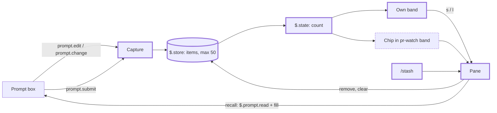
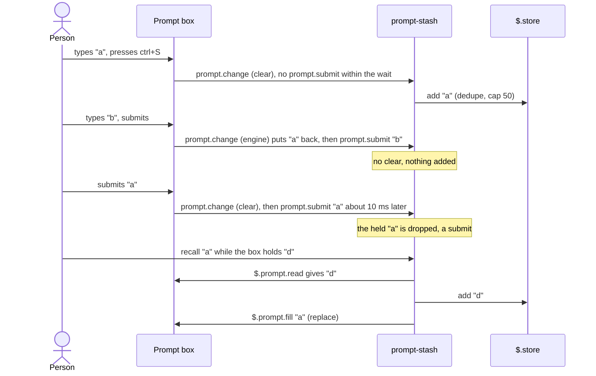
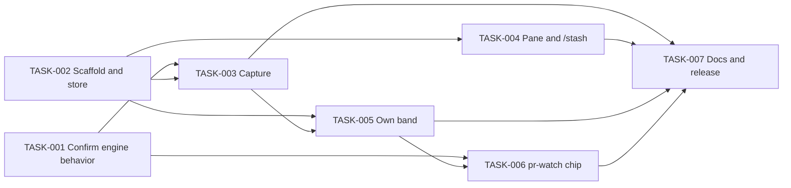

# PRD-20261015-prompt-stash — prompt-stash: a managed history for the native prompt stash

## Context and Problem

Claude Code's native stash (ctrl+S) parks the draft in the prompt box so it is not sent while Claude works, and puts it back after the next submit. It works well, but it holds one draft: a second stash replaces the first, there is no list to look at, and a parked draft cannot be removed or recalled on its own. The draft is parked precisely to keep a separate subject out of the current context without forgetting to bring it up later; with one slot, the second subject pushes the first out.

## Interview notes

- **Problem:** the native stash is good but keeps a single draft, with no history and no management.
- **Outcome:** every stashed draft stays recoverable, listed, and removable one by one or all at once, without being sent and without adding anything to the model's context.
- **Scope:** in: passive capture of every non-empty draft that leaves the box without a submit; a hotkey to stash the current draft; a pane to list, recall (swap), remove one and clear all with confirmation; a count in the band, or a chip in pr-watch's band when it draws; a local store of up to 50 items, global with a per-project filter. Out: syncing between machines, images and other attachments of a draft (text only), editing an item in place, sending an item from the pane, reminders.
- **Constraints:** keep the native ctrl+S as the main gesture and do not fight it; take little screen space, no extra line when pr-watch already draws a band; nothing the plugin does reaches the model's context.
- **Approach:** capture through the native stash (A) plus a band hotkey (B); manage in a pane opened by `/stash` or from the band; with pr-watch, a compact chip in its band opens the same pane.
- **Risks:** the engine raises the same `prompt.change` (`clear`) for a submit, a stash and a clear, and reports the box after the change, so capture tracks the draft through `prompt.edit` and waits briefly for a submit (see Decisions, confirmed in TASK-001); the mods API is young and may change (the weekly latest-Claude-Code workflow catches it); drafts are stored as plain JSON on disk, as Claude Code's own prompt history already is.
- **Dependencies:** a small change in pr-watch to draw the chip; Claude Code 2.1.300 or newer (see Decisions).

## Goals

- [ ] Three drafts stashed in a row with ctrl+S are all in the pane, newest first, each recallable in any order without being sent.
- [ ] A draft cleared with ctrl+c is in the pane as well.
- [ ] With pr-watch showing pull requests, stashing does not add a line above the prompt.
- [ ] With an empty list, prompt-stash draws nothing above the prompt.
- [ ] No action of the plugin adds a row the model reads to the conversation.

## Non-goals

- Replacing or rebinding the native ctrl+S, or changing how it puts the draft back after a submit.
- Syncing the list between machines.
- Keeping images or other attachments of a draft; only its text is stored.
- Editing an item in place, searching the list, or sending an item straight from the pane.
- Reminders (toasts or notifications) about stashed items.

---

## Functional Requirements

### FR-001 — Passive capture

The system shall add to the list every non-empty draft that leaves the prompt box without being submitted (the native stash, ctrl+c), tagged with the project of the session and the time.

**Acceptance criteria:**
- When the person presses ctrl+S on the draft "a", "a" is the newest item, tagged with the current project.
- When a draft is submitted, it is not added.
- When the box is emptied while it holds only whitespace, nothing is added.
- When the draft equals an item already in the list, no new item is added and the existing one becomes the newest.
- When a 51st item is added, the oldest item is dropped.

### FR-002 — Stash hotkey

The user can stash the current draft with a single hotkey from the band or the pane, which adds it to the list and empties the prompt box without sending it.

**Acceptance criteria:**
- When the box holds "b" and the person presses the hotkey, "b" is the newest item and the box is empty.
- When the box is empty, the hotkey changes nothing and says so in a toast.

### FR-003 — Own band

When the list has items for the current view and pr-watch draws no band, the system shall draw one line above the prompt with the count and the actions to stash and to open the list.

**Acceptance criteria:**
- When the list is empty, nothing is drawn above the prompt.
- When pr-watch draws its band, prompt-stash does not draw its own line.

### FR-004 — Chip in pr-watch's band

When prompt-stash has items, pr-watch shall draw a compact chip with the count in the line it already draws; pressing it opens the prompt-stash pane.

**Acceptance criteria:**
- With pull requests watched and three items stashed, the band has the same number of lines as without the chip.
- When prompt-stash is not installed, or its list is empty, pr-watch draws exactly what it draws today.

### FR-005 — Pane

The user can open a pane with `/stash`, from the band or from the chip, listing the items newest first with the start of the text, how long ago it was stashed and the project; by default it shows the current project's items, and the user can switch to all projects.

**Acceptance criteria:**
- When items exist for two projects, the pane opened in project X lists only X's items until the person switches to all.
- `/stash` adds no text the model reads to the conversation.

### FR-006 — Recall

The user can recall an item into the prompt box without sending it; when the box holds a draft, that draft is added to the list first (swap). The recalled item stays in the list.

**Acceptance criteria:**
- With an empty box, recalling "c" puts "c" in the box and nothing is sent.
- With "d" in the box, recalling "c" puts "c" in the box and "d" becomes the newest item.
- After the recall, "c" is still in the list.

### FR-007 — Remove one

The user can remove a single item from the pane.

**Acceptance criteria:**
- After removing "c", the pane no longer lists it and the other items are unchanged.

### FR-008 — Clear with confirmation

The user can clear the items the pane shows, after confirming a question that states how many items will be removed.

**Acceptance criteria:**
- When the person declines, nothing is removed.
- When the pane shows the current project and the person confirms, only that project's items are removed.

---

## Non-functional Requirements

| Attribute | Requirement |
|---|---|
| Performance | Typing in the prompt box has no added delay; the store is written only when an item is added or removed, never per keystroke |
| Security | Drafts stay in the plugin's local store; the plugin makes no network call and sends nothing to the model |
| Observability | A failed store write shows a toast; nothing else is logged |
| Compatibility | Claude Code 2.1.300 or newer, the first with `prompt.change`; prompt-stash works without pr-watch and pr-watch works without prompt-stash; the terminal is the supported surface |

---

## Overview

Components and how they connect. New: everything in prompt-stash; changed: pr-watch's band.

Capture and recall (FR-001, FR-002, FR-006).

## Decisions

| Decision | Alternatives considered | Rationale |
|---|---|---|
| Name `prompt-stash`, command `/stash` | `prompt-stack`, `shelf` | Extends a concept Claude Code already has (ctrl+S) and is what someone would search for; `stack` implies last-in-first-out, the limit being removed |
| One global list, each item tagged with its project, filtered to the current project by default | One list per project | A subject sometimes spans repos; the filter keeps the default view focused |
| Recalling an item keeps it in the list | Remove on recall (`pop`) | Non-destructive; removal stays an explicit action |
| No reminder by default | Toast when a turn ends with stashed items | The count in the band is the reminder; a toast would be noise |
| Keep at most 50 items, dropping the oldest | No limit | Bounds the store (4 MiB per plugin) and the list |
| Capture through the native ctrl+S (A) and a band hotkey (B) | Band only; `/stash <text>` | The native gesture is the habit; the hotkey covers a deterministic capture |
| Manage in a pane: recall into the prompt box without sending, remove one, clear all with confirmation | Slash commands per action | One place to see and act; nothing reaches the model |
| With pr-watch drawing, a chip in its band (pr-watch reads prompt-stash's count from `$.state`); prompt-stash draws its own one-line band only when pr-watch draws nothing, and nothing when the list is empty | prompt-stash wraps pr-watch's tree through `next(e)`; a separate line always | No extra line and no dependence on hook order: pr-watch answers its band without calling `next`, so whichever plugin sits above would hide the other |
| Record every non-empty draft that leaves the box without a submit (stash, ctrl+c); an identical text moves the existing item to the top | Ignore short drafts; band hotkey only | The engine does not tell a stash from a clear; no draft is lost, and the noise is removed in the pane |
| Recalling into a non-empty box swaps: the current draft goes to the list | Ask each time; append | Nothing is lost and no dialog; appending would mix the subjects the stash keeps apart |
| Clear removes the items in the pane's current view, with their count in the question | Clear every item of every project | Matches what the person sees; clearing other projects' items unseen would surprise |
| Track the draft from `prompt.edit` (the box after each edit) and `prompt.change` (history, plugin and engine writes); on `prompt.change` `clear`, hold the draft it emptied and record it unless a `prompt.submit` with the same text arrives within a short wait | Read the box on `clear`; drop the item when a submit follows | Measured on 2.1.301 (TASK-001): `clear` reports the box already empty; a plain submit raises `clear` about 10 ms before `prompt.submit`; with a stash pending, a submit raises no `clear`, the engine puts the stash back (`engine`) about 20 ms before `prompt.submit`; ctrl+S and ctrl+c raise `clear` with no submit. Dropping after the fact could delete an item the person recalled and then sent |
| esc esc is not a capture source | Keep it in the requirements | On 2.1.301, esc esc with a draft in the box leaves the draft there (TASK-001) |
| pr-watch reads `{ plugin: 'prompt-stash', key: 'count' }` from `$.state` with no `dependencies` entry | Declare prompt-stash as a dependency | `claude plugin validate` passes, listing the read under state of other plugins, not checked; at runtime the value reads as set (`{ value, version }`) when prompt-stash is loaded and as `{ version: 0 }` with no value when it is not (TASK-001) |
| prompt-stash requires Claude Code 2.1.300; CI validates and tests each plugin on the version in its `claude-code-version` file (prompt-stash 2.1.300, pr-watch the 2.1.292 default) | Keep 2.1.292 and drop the passive capture; raise the CI pin for every plugin | `prompt.change` first ships in 2.1.300 (2.1.292 to 2.1.299 refuse the module), and passive capture through the native ctrl+S is the core of the plugin. A per-plugin version keeps pr-watch tested on its documented minimum. Found when CI failed on the stacked PRs |
| Local store per machine (`$.store`) | A file at a configurable path (for example the synced vault) | A stash is work in progress on one machine, as the native one; no sync conflicts and drafts do not leave the machine |

---

## Dependencies

- Depends on: pr-watch (chip in its band; optional at runtime)
- Blocks: None

---

## Tasks

| Task | Title | Status | Pull request |
|---|---|---|---|
| [TASK-001](./TASK-001-confirm-engine-behavior.md) | Confirm the engine behavior the design relies on | In Review | https://github.com/heidiks/agent-kit/pull/37 |
| [TASK-002](./TASK-002-plugin-scaffold-and-store.md) | Plugin scaffold and the item store | In Review | https://github.com/heidiks/agent-kit/pull/39 |
| [TASK-003](./TASK-003-capture.md) | Passive capture and the stash action | Todo | - |
| [TASK-004](./TASK-004-pane-and-command.md) | The /stash command and the pane | In Review | https://github.com/heidiks/agent-kit/pull/41 |
| [TASK-005](./TASK-005-own-band.md) | Own band and the published count | Todo | - |
| [TASK-006](./TASK-006-pr-watch-chip.md) | Chip in pr-watch's band | Todo | - |
| [TASK-007](./TASK-007-docs-and-release.md) | Docs and first release | Todo | - |

---

## Open Questions

- [x] Order of `prompt.change` (`clear`) and `prompt.submit` on a submit: answered in TASK-001, see Decisions.
- [x] Whether pr-watch can read prompt-stash's `$.state` without `dependencies`: yes, see Decisions.
