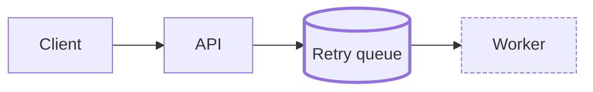

# Phase 3: Visual overview

Give the reader the shape of the plan in one glance, inside `spec.md`, so it is
versioned and reviewed with the rest of the PRD: Mermaid diagrams for the flow and, when
the work changes something a person sees and the user wants it, a mockup of that interface.

## Format: Mermaid

Use Mermaid code blocks. GitHub and Azure DevOps render them, they diff well in PRs, and
they need no extra tool.

## What to draw

Draw only what helps; one or two diagrams is usually right.

| Situation | Diagram |
|---|---|
| Request or event flow across components | `sequenceDiagram` |
| Components touched and how they connect | `flowchart LR` |
| Lifecycle of an entity (order, job, document) | `stateDiagram-v2` |
| Data model changes | `erDiagram` |

Mark what is new or changed so the reader sees the delta, for example with a class:

````markdown

````

## Interface mockup

When the work changes something a person sees (a screen, a component, CLI or terminal
output, a band or panel, an email, a report), ask once, before drawing, whether the user
wants to see it. Skip the question for work with no interface.

> This change has an interface. Do you want a mockup in the PRD?
> 1. Text in `spec.md` (recommended): cheap, readable in any diff
> 2. SVG in the PRD folder: closer to the real look, harder to review as a diff
> 3. No mockup

If the agent can also render a richer preview (an HTML page, an artifact), offer it as an
extra outside the repo; what goes in the repo is the text or the SVG.

- **Text:** under `### Interface` in the Overview, a `text` code block that draws the
  screen in characters, one block per state that matters (empty, with data, error).
- **SVG:** `mockups/<name>.svg` beside `spec.md`, hand-written with text elements so it
  stays readable, shown under `### Interface` with an image tag; one file per state that
  matters, and a dark variant through `<picture>` when the repo's other images have one.
- **No mockup:** write "Interface: no mockup (declined)" under `### Interface`, so whoever
  resumes knows it was asked.

Use the labels, counts and states the requirements name, never placeholders like
"Lorem ipsum" or "Button".

## Rules

- Keep each diagram under about 15 nodes; split it if it grows.
- Use the names that exist in the codebase (service, package, table), not invented ones.
- The diagrams and the mockup must agree with the Requirements and Decisions; if drawing
  them exposes a gap, add it to Open questions.

The task graph is drawn in phase 4, not here.

Then run the checkpoint from SKILL.md.
